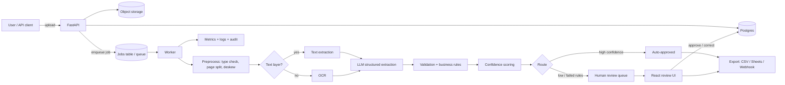

# AI Document Processing Pipeline — Full Project Plan

**Working name:** DocFlow AI
**Goal:** A client-level system that turns invoices and similar documents (PDF/images) into validated, structured data, routes uncertain results to a human reviewer, and exports approved data to business tools.
**Primary document type:** Invoices (EN + AR). Receipts as a second type to prove the schema system is configurable.
**Effort:** ~21.5 working days (1 day ≈ 4 focused hours, so ~86 hours), plus a 20% buffer.
**Calendar time:** ~4 weeks at 3–4 h/day, or ~2.5–3 weeks full-time.

> Note: my earlier "1.5–2 weeks" estimate was for a lean build. This plan includes the hardening a client expects (security, retries, audit trail, evaluation, CI). A lean cut is in section 12.

---

## 1. Positioning

**One-line pitch:** "Upload a pile of invoices, get clean structured data, with a human checking only what the system isn't sure about."

**What it proves to a client**
- You can ship a real pipeline, not a notebook: API, queue, database, UI, deployment.
- You handle failure: bad scans, duplicates, wrong totals, LLM outages.
- You measure quality: a benchmark with field-level accuracy, not "it looks good".
- You think about security, cost, and auditability.

**Honest framing:** all documents are synthetic (no real personal or company data). Say so in the README and on the demo.

---

## 2. What "Client-Level" Means (acceptance checklist)

- [ ] Live deployed API and web frontend
- [ ] Authentication and roles (admin, reviewer)
- [ ] Asynchronous processing with a job queue, retries, and idempotency
- [ ] Hybrid extraction (text layer + OCR + LLM), not a single prompt
- [ ] Validation rules and field-level confidence
- [ ] Human review screen with audit trail
- [ ] Duplicate detection
- [ ] Exports (CSV, Google Sheets, signed webhook)
- [ ] Benchmark with reported accuracy, cost, and latency
- [ ] Structured logs, health checks, error tracking
- [ ] Automated tests and CI
- [ ] Docker setup and clear README with architecture diagram
- [ ] Documented failure scenarios and how each is handled

---

## 3. Scope

### In scope (MVP)
- Upload single or batch files (PDF, PNG, JPG)
- Digital PDFs and scanned/photographed documents
- English and Arabic invoices
- Header fields: vendor, invoice number, dates, currency, subtotal, tax, total
- Line items: description, quantity, unit price, line total
- Validation, confidence scoring, review queue, export

### Out of scope (stretch, later)
- Multi-tenant organizations and billing
- Handwriting recognition
- Fine-tuning custom layout models
- Learning automatically from corrections
- Real accounting-system integrations (use a mock API)

---

## 4. Architecture



**Key design decisions**
- **Hybrid extraction:** read the PDF text layer first (cheap, accurate). Use OCR or a vision model only when needed.
- **Provider interface:** the LLM/OCR provider sits behind an adapter so you can swap models and run benchmarks across them.
- **Postgres-backed queue:** one fewer service to host on a free tier. Workers claim jobs with `SELECT ... FOR UPDATE SKIP LOCKED`. Locally, run the worker as its own container. On a free tier that has no background workers, run it in-process. Document this trade-off in the README.
- **Versioned everything:** prompt version, schema version, and model name are stored on each extraction so results are reproducible.
- **Modular monolith:** one deployable backend, organized as a generic `platform/` layer plus one self-contained module per business feature (see section 14). Business logic is kept apart from infrastructure, so the pipeline can sit inside a larger SaaS and new features become new modules.

---

## 5. Tech Stack

| Layer | Choice | Why | Alternative |
|---|---|---|---|
| Backend API | Python, FastAPI, Pydantic v2 | You know it; typed schemas fit extraction | — |
| Database | Postgres (Neon) + SQLAlchemy 2 + Alembic | Reliable, migrations, free tier | Supabase |
| Queue | Postgres jobs table + worker loop | No extra infra | Celery + Redis |
| File storage | Local volume (dev), S3-compatible bucket (prod) | Clients expect object storage | Cloudflare R2, Supabase Storage |
| PDF text | PyMuPDF (fitz) | Fast text-layer extraction | pdfplumber |
| OCR | Tesseract with Arabic + English packs | Free, supports Arabic | A cloud OCR API |
| LLM extraction | Vision-capable LLM behind a provider adapter, structured JSON output validated by Pydantic | Handles messy layouts | Any provider that supports structured output |
| Validation | Pydantic + custom rule engine | Explicit, testable rules | — |
| Frontend | React + Vite + TypeScript + Tailwind | Standard client stack; build the first version with your AI app builder from a brief | Next.js |
| Auth | JWT (email/password) + API keys for programmatic access | Covers UI and integrations | Auth provider |
| Exports | CSV, Google Sheets API, HMAC-signed webhook | Common client needs | — |
| Observability | structlog (JSON logs), `/health`, Sentry (free tier), optional Langfuse/LangSmith for LLM traces | Debuggable in production | OpenTelemetry |
| Testing | pytest, golden-set benchmark script | Quality you can measure | — |
| CI/CD | GitHub Actions, Docker, docker-compose | Reproducible builds | — |
| Hosting | Backend on Render/Fly/Railway, frontend on Vercel/Netlify/Cloudflare Pages, DB on Neon | Free or cheap | — |

> Check current free-tier limits and available vision models at build time, and keep the model choice behind the adapter so nothing is locked in.

---

## 6. Systems to Take Care Of

| # | System | What to build | Why a client cares |
|---|---|---|---|
| 1 | **Ingestion and file safety** | Validate type by magic bytes, size limit, page limit, reject password-protected or corrupt files with a clear error, store files under hashed names | Bad uploads are the most common failure |
| 2 | **Job queue and reliability** | Job states (queued, processing, done, failed, needs_review), retries with exponential backoff, timeouts, dead-letter state, idempotent processing keyed by file hash | Nothing gets lost or processed twice |
| 3 | **Extraction quality** | Text layer first, OCR fallback, LLM structured output, multi-page handling, prompt and schema versioning | The core of the product |
| 4 | **Validation rules** | Line items sum to subtotal, subtotal + tax = total, date sanity, currency format, required fields, vendor name normalization | Catches errors the LLM can't see |
| 5 | **Confidence and routing** | Per-field confidence from validation results, agreement between text-layer and LLM values, and model signals. Thresholds decide auto-approve vs review. Do not trust the model's self-reported confidence alone | Saves reviewer time without risking bad data |
| 6 | **Human review and audit trail** | Side-by-side document viewer and editable fields, highlight low-confidence fields, record who changed what and when, keep original and corrected values | Auditability is a hard requirement for finance |
| 7 | **Duplicate detection** | File hash plus (vendor, invoice number, total, date) fuzzy match, flag for review | Duplicate payments cost real money |
| 8 | **Security and privacy** | Hash passwords, JWT expiry, role checks, API key hashing, rate limiting, CORS, signed download URLs, no PII in logs, data retention and delete-document endpoint, secrets in environment variables | Clients ask about this first |
| 9 | **Cost and latency control** | Cache by file hash, skip LLM when text layer is clean and rules pass, page limits, per-document cost tracking, model fallback | Keeps unit economics visible |
| 10 | **Exports and integrations** | CSV, Google Sheets, webhook with HMAC signature and retries, idempotent export records | Data must reach their tools |
| 11 | **Observability** | Structured logs with request and job IDs, metrics (throughput, failure rate, latency, cost), health endpoint, error tracking | You can debug without guessing |
| 12 | **Evaluation** | Golden set with ground truth, field-level accuracy, per-document-type breakdown, run in CI | Proves the system works with numbers |
| 13 | **Failure scenarios** | Blurry scan, rotated page, mixed languages, missing fields, malformed model output, provider rate limit or outage, huge file, duplicate upload | Shows production thinking |
| 14 | **Schema registry** | Document types defined as config (fields, rules, prompt), starting with invoice and receipt | Extensible to new document types |
| 15 | **Deployment and docs** | Dockerfiles, compose, env template, CI, README, API docs (OpenAPI), architecture diagram | Looks and works like a real product |

---

## 7. Data Model

- `organizations` — id, name (a single default organization is seeded; no org management is built, it is only a seam for a future multi-tenant SaaS)
- `users` — id, organization_id, email, password_hash, role, created_at
- `api_keys` — id, user_id, key_hash, last_used_at, revoked_at
- `documents` — id, owner_id, filename, file_hash, storage_path, mime_type, page_count, status, doc_type, created_at
- `jobs` — id, document_id, state, attempts, next_run_at, last_error, locked_at, created_at
- `extractions` — id, document_id, schema_version, prompt_version, model, fields (JSON), confidences (JSON), validation_errors (JSON), cost, latency_ms, created_at
- `review_events` — id, extraction_id, user_id, action, field, old_value, new_value, created_at
- `exports` — id, extraction_id, target, state, attempts, response, created_at
- `duplicates` — id, document_id, matched_document_id, reason, score

> `organization_id` is also added to `documents`, `extractions`, and `exports`. Adding it now costs almost nothing; retrofitting tenancy later is painful.

---

## 8. API Endpoints (draft)

| Method | Path | Purpose |
|---|---|---|
| POST | `/auth/register`, `/auth/login` | Accounts and tokens |
| POST | `/documents` | Upload one or many files |
| GET | `/documents` | List with status and filters |
| GET | `/documents/{id}` | Details, extraction, validation errors |
| GET | `/documents/{id}/file` | Signed file URL |
| DELETE | `/documents/{id}` | Delete document and data |
| GET | `/review/queue` | Documents needing review |
| POST | `/review/{extraction_id}/approve` | Approve (with or without corrections) |
| POST | `/review/{extraction_id}/reject` | Reject with reason |
| POST | `/exports` | Export approved documents |
| GET | `/metrics/summary` | Throughput, auto-approve rate, accuracy, cost |
| GET | `/health` | Liveness and dependency checks |

---

## 9. Frontend Screens

1. **Login**
2. **Upload and queue:** drag-and-drop, batch status, retry failed
3. **Review screen:** document viewer on the left, editable fields on the right, low-confidence fields highlighted, validation errors listed, approve / correct / reject
4. **Documents table:** filters by status, vendor, date, confidence
5. **Dashboard:** documents processed, auto-approve rate, review rate, average latency, cost per document, failure reasons
6. **Exports and settings:** targets, API keys, thresholds

---

## 10. Timeline (1 day ≈ 4 focused hours)

| Phase | Work | Days |
|---|---|---|
| 0 | Repo, modular skeleton (`platform/` + `modules/`), layering rules, Docker compose, decide document types and fields | 1.5 |
| 1 | Synthetic dataset and ground truth: generate 40–60 invoices (EN/AR; digital, scanned, rotated, blurry, low-res; edge cases) | 1.5 |
| 2 | Core extraction: text layer, OCR fallback, LLM structured extraction, provider adapter, prompt and schema versioning, CLI over dataset, **baseline accuracy** | 3 |
| 3 | Validation rules, confidence scoring, routing logic, duplicate detection | 2 |
| 4 | API, Postgres, migrations, storage, job queue, retries, auth | 3 |
| 5 | Frontend: upload, review screen, table, dashboard | 3.5 |
| 6 | Exports: CSV, Google Sheets, signed webhook | 1.5 |
| 7 | Hardening: security, rate limits, structured logs, error tracking, failure scenarios | 2 |
| 8 | Evaluation report, tests, CI | 1.5 |
| 9 | Deploy, README, diagrams, demo video, case study, Upwork listing | 2 |
| | **Total** | **21.5** |

### Week-by-week milestones (at ~3–4 h/day)

| Week | Target | Demo-able checkpoint |
|---|---|---|
| 1 | Phases 0–2 | Command-line run over the dataset with a baseline accuracy number |
| 2 | Phases 3–4 | Upload via API, async processing, results in the database |
| 3 | Phases 5–6 | Full UI flow: upload, review, approve, export |
| 4 | Phases 7–9 | Live deployed system, README, case study, demo video |

Add a 20% buffer for debugging OCR, Arabic text, and deployment issues.

---

## 11. Evaluation Plan (the differentiator)

- **Golden set:** 40–60 synthetic documents with ground-truth JSON, split into digital, clean scans, and degraded scans, plus Arabic and English.
- **Metrics:**
  - Field-level exact-match accuracy (per field and overall)
  - Line-item accuracy
  - Total-amount accuracy
  - Auto-approve rate and, among auto-approved documents, the error rate
  - Review rate
  - p50 / p95 latency per document
  - Cost per document
- **Comparisons to report:** (a) LLM-only vs hybrid pipeline, (b) with vs without validation rules, (c) two different models behind the adapter.
- **Targets:** set after the baseline run. As a starting aim, high accuracy on digital documents and a clearly lower but reported number on degraded scans. Never hide the weak cases.
- **CI gate:** fail the build if accuracy on the golden set drops below the agreed threshold.
- **Case study:** "Hybrid extraction plus validation cut errors from X% to Y%," with a table and examples of caught mistakes.

> This work also becomes the foundation for the evaluation and observability layer you postponed. Keep the metrics tables and trace fields reusable.

---

## 12. Lean Cut (if time is short, ~11–12 days)

Keep: hybrid extraction, validation, confidence routing, review UI, CSV export, deployment, benchmark.
Drop or postpone: Arabic support, Google Sheets and webhooks, receipts, duplicate fuzzy matching, API keys, dashboard charts.

---

## 13. Risks and Mitigations

| Risk | Mitigation |
|---|---|
| Arabic OCR quality is poor | Test early (Phase 1–2), prefer text layer, use a vision model for scans, report the gap honestly |
| Model free-tier rate limits slow benchmarks | Cache by file hash, batch runs, small judge samples, retry with backoff |
| Free-tier hosting sleeps or has no background workers | In-process worker mode, document cold starts, keep a docker-compose path |
| Scope creep | Freeze the MVP list; stretch items only after Phase 9 |
| Fake-looking demo data | Label as synthetic, include messy and failure cases, lead with the benchmark |
| Frontend takes too long | Generate the first version with the AI app builder from a brief, then wire it to the API |

---

## 14. Repository Structure (modular monolith)

**Principles**
- `platform/` holds generic infrastructure that knows nothing about invoices. Any future feature could reuse it.
- `modules/` holds one folder per business feature, each a self-contained slice.
- Inside each module, a fixed layering separates HTTP, business logic, and data access.
- Abstract only what genuinely changes (LLM provider, storage backend, exporters). No interfaces for everything.

```
docflow-ai/
├── backend/
│   ├── app/
│   │   ├── main.py                  # builds the app, registers module routers
│   │   ├── worker_main.py           # worker entrypoint, registers job handlers
│   │   │
│   │   ├── platform/                # generic, feature-agnostic
│   │   │   ├── config.py
│   │   │   ├── security.py          # password hashing, JWT, HMAC signing
│   │   │   ├── logging.py           # structured logs with request/job IDs
│   │   │   ├── errors.py            # base exceptions, retryable vs permanent
│   │   │   ├── db/                  # session, base model, migrations
│   │   │   ├── storage/             # local + S3 backends
│   │   │   └── jobs/                # generic queue: claim, retry, backoff
│   │   │
│   │   └── modules/
│   │       ├── auth/                # users, roles, API keys
│   │       ├── documents/           # upload, lifecycle, process_document job
│   │       ├── extraction/          # text layer, OCR, LLM providers, schemas, prompts
│   │       ├── validation/          # rules, confidence, duplicates, routing
│   │       ├── review/              # review queue, corrections, audit trail
│   │       ├── exports/             # CSV, Sheets, webhook
│   │       └── metrics/             # dashboard numbers
│   │
│   ├── tests/                       # mirrors modules/
│   ├── pyproject.toml
│   └── Dockerfile
├── frontend/
│   └── src/
│       ├── features/                # documents, review, dashboard, auth
│       ├── components/ui/           # shared UI pieces
│       └── lib/                     # API client, helpers
├── evals/
│   ├── dataset/                     # synthetic docs + ground truth
│   ├── run_benchmark.py
│   └── reports/
├── docs/                            # architecture diagram, failure scenarios, API notes
├── docker-compose.yml
├── .github/workflows/ci.yml
├── .gitignore
├── .env.example
└── README.md
```

### Standard layout inside every module

```
modules/validation/
├── router.py        # HTTP only (if the module exposes endpoints)
├── schemas.py       # API request/response models
├── service.py       # use cases: the business logic entry points
├── domain/          # pure business rules: no DB, no HTTP, no I/O
│   ├── rules.py
│   ├── confidence.py
│   └── routing.py
├── repository.py    # database access
├── models.py        # DB tables owned by this module
└── __init__.py      # the module's public interface
```

`extraction/` adds its own subfolders: `providers/` (base interface plus one file per LLM), `prompts/`, `schemas/` (invoice, receipt, registry), plus `text_layer.py`, `ocr.py`, `preprocess.py`, and `extractor.py`.

### Request flow

`router` (HTTP only) → `service` (business logic) → `repository` (database) and `platform` (storage, jobs).

Upload example: the router parses the request and calls `service.upload()`. The service validates the file, checks the file hash for an existing upload (idempotent), saves it through `platform/storage`, creates the `documents` row, and enqueues a `process_document` job through `platform/jobs`. The router returns `202 Accepted`.

### Dependency rules

1. `platform` never imports from `modules`.
2. Routers contain no business logic. They call a service and return the result.
3. `domain/` is pure: no database, no HTTP, no network. That is why validation and extraction logic can be unit-tested and benchmarked before the API exists.
4. Modules talk to each other only through their public interface (service functions exported in `__init__.py`), never by reaching into another module's tables or internals.
5. The worker is an entrypoint, not a feature. `platform/jobs` provides the queue mechanics; each module registers its own job handlers. The `process_document` handler lives in `documents` and orchestrates `extraction` and `validation`.
6. Enforce rules 1 and 4 in CI with `import-linter`, so a layering violation fails the build.

### Keep it SaaS-ready without overbuilding

- SaaS-wide pieces (`auth`, `platform`, `metrics`, `jobs`, `storage`) are generic from day one.
- A future feature (contracts, or the postponed evaluation layer) becomes a new folder under `modules/`.
- Leave the `organization_id` seam (section 7). Do not build org management, billing, or extra roles in this project.

---

## 15. Packaging for Upwork

**Portfolio title:** AI Document Processing Pipeline — Invoice Extraction with Human Review

**Description template:**
> Production-style system that extracts structured data from invoices (English and Arabic, digital and scanned), validates it with business rules, and sends only uncertain documents to a human reviewer. Includes async processing with retries, audit trail, duplicate detection, exports to CSV / Google Sheets / webhooks, and a benchmark showing field-level accuracy, latency, and cost. Built with FastAPI, Postgres, React, and a swappable LLM/OCR layer. All demo data is synthetic.

**Assets to prepare**
- [ ] Live demo link and a demo login
- [ ] 2–3 minute video: upload batch, see a blurry scan routed to review, correct it, export
- [ ] Screenshots: review screen, dashboard, failure case
- [ ] Architecture diagram
- [ ] Case study with the benchmark table
- [ ] GitHub repo with a polished README

**Demo script (video)**
1. Upload 10 mixed documents
2. Show most auto-approved, a few flagged
3. Open a flagged blurry scan and show highlighted low-confidence fields
4. Correct and approve, then show the audit trail
5. Export to Google Sheets
6. Show the dashboard and the benchmark numbers

---

## 16. Build Order (first week, concrete)

1. Create the repo with the modular skeleton (`platform/` + `modules/`), add the layering rules (`import-linter`), and a Docker compose file with Postgres
2. Write the invoice schema and the generator for synthetic documents
3. Generate the dataset and ground-truth files
4. Build the text-layer extractor and OCR fallback
5. Add the LLM extractor behind the provider adapter
6. Write the benchmark script and record the baseline accuracy
7. Only then start the API, queue, and UI

Doing the benchmark before the API means every later change is measured.

---

## 17. Stretch Goals (after launch)

- Add the evaluation and observability layer across all three projects
- Add contracts or receipts as new document types via the schema registry
- Learn from reviewer corrections to improve prompts
- Table-structure extraction for complex line items
- Multi-tenant organizations